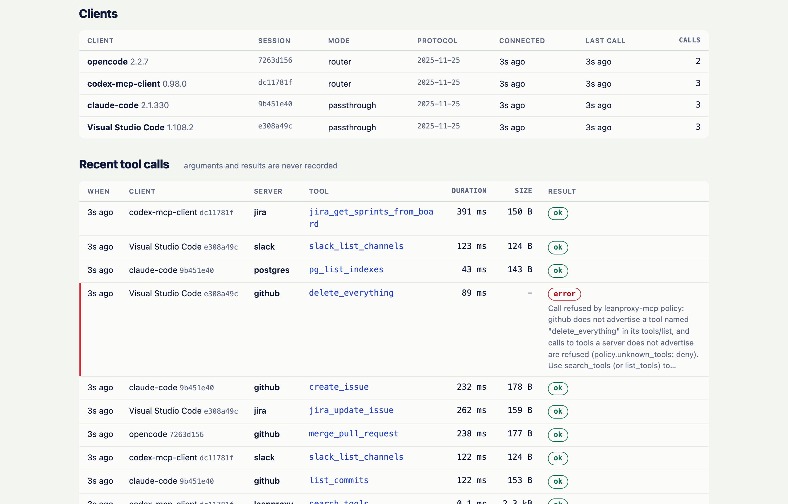
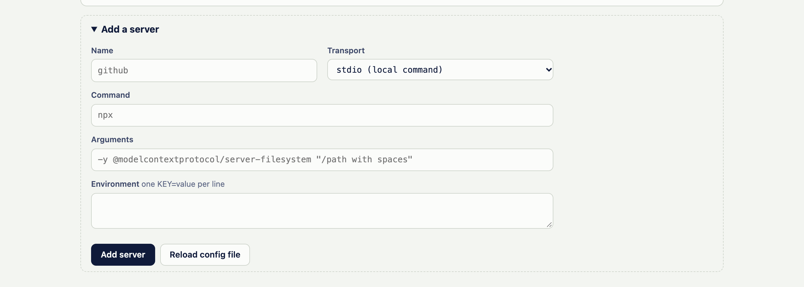

# Shared Gateway and Admin Dashboard

By default every MCP client session starts its own LeanProxy: the client
runs `leanproxy-mcp server run --stdio`, and that process starts its own
copy of every upstream server. Ten sessions (IDE windows, agents,
sub-agents) are ten proxies and ten copies of each stdio server, each with
its own state, and nothing shows them together.

The shared gateway is the other way to run it: **one** `server run --http`
process that every client reaches by URL.

<div class="lp-video">
<iframe src="../videos/shared-gateway/?embed=1&lang=en" title="LeanProxy: one shared gateway (70 second video)" loading="lazy" allow="fullscreen; autoplay" allowfullscreen></iframe>
</div>

*The 70-second tour, with subtitles (press `c`). The dashboard shown uses demo servers.*

| | One proxy per session (`--stdio`) | Shared gateway (`daemon`) |
|---|---|---|
| Proxy processes | One per client session | One |
| Upstream servers | One copy per session | One copy, shared |
| Remote connections, OAuth sessions | One per session | One |
| Status | One status file per process | One place: `status` and the dashboard |
| Adding a server | Restart every client | Picked up in seconds, no restart |

## Install the service

```bash
leanproxy-mcp daemon install
```

This installs a per-user service (a launchd agent on macOS, a `systemd
--user` unit on Linux) that starts at login, is restarted if it exits, and
runs:

```
leanproxy-mcp server run --http 127.0.0.1:8765 \
  --dashboard-bind 127.0.0.1:9090 --dashboard-token-file ~/.config/leanproxy/dashboard.token \
  --log-file ~/.leanproxy/logs/daemon.log
```

| Flag | Default | Description |
|------|---------|-------------|
| `--http` | `127.0.0.1:8765` | Address of the MCP endpoint. Loopback only. |
| `--dashboard` | `127.0.0.1:9090` | Address of the dashboard, or `off`. Loopback only. |
| `--log-level` | `info` | Log level of the service. |
| `--config` | the usual location | Path to `leanproxy_servers.yaml`. |

The service runs with the `PATH` of the shell that installed it, so the
commands of your stdio servers (`npx`, `uvx`, `docker`, ...) resolve the
way they do for you. Run `daemon install` again after changing your `PATH`
or upgrading LeanProxy to a different location.

Each endpoint has its own bearer token, in a file created on first start
with mode `0600`: `~/.config/leanproxy/serve.token` for the MCP endpoint
(the one your clients carry in their configuration) and
`~/.config/leanproxy/dashboard.token` for the dashboard. They are
separate on purpose: the dashboard can add servers, which runs commands,
so a client's token must not open it. Neither token appears on the
service's command line.

Other subcommands:

| Command | What it does |
|---------|--------------|
| `daemon status` | Is the gateway running, its URLs, clients and servers. Also says when separate `--stdio` proxies are still running. |
| `daemon clients` | The snippet to paste into each MCP client. `--show-token` prints the real token. |
| `daemon open` | Opens the dashboard in the browser, already signed in. The link carries a code that works once, for one minute, not the token. |
| `daemon restart` | Restarts the service. |
| `daemon uninstall` | Stops and removes it. |

## Connect your clients

```bash
leanproxy-mcp daemon clients --show-token
```

prints the configuration for Claude Code, Codex CLI, VS Code / GitHub
Copilot, Cursor, OpenCode and Claude Desktop. For Claude Code:

```bash
claude mcp remove leanproxy
claude mcp add --transport http --scope user leanproxy http://127.0.0.1:8765/mcp \
  --header "Authorization: Bearer <token>"
```

### Clients that can only start a command

Claude Desktop's `claude_desktop_config.json` (and some older plugins)
accept a command, not a URL. Give them the bridge:

```json
{ "mcpServers": { "leanproxy": { "command": "leanproxy-mcp", "args": ["connect"] } } }
```

`leanproxy-mcp connect` relays the client's stdin and stdout to the
gateway. Unlike `server run --stdio` it starts no upstream server: the
client shares the gateway's servers with every other client. It finds the
gateway and its token by itself (`--url` and `--token-file` override
them), and if the gateway restarts it initializes again on the next
request. When no gateway runs and the service is not installed, it starts
one: see [Without a service](#without-a-service-start-on-demand). All the checks (redaction, policy, pinning) still happen in the
gateway.

Remove the old `server run --stdio` entry from each client, or that client
keeps starting its own proxy. `leanproxy-mcp daemon status` tells you when
some are left.

Each client still gets its own session on the gateway: its own exposure
mode (router or passthrough, decided from its `clientInfo.name`), its own
policy approvals and its own governed results.

!!! note "Requests an upstream server sends back to a client"
    A stdio upstream that asks for an elicitation or sampling does not say
    which call it is asking about. With calls from one client in flight the
    request goes to that client. With calls from **several** clients in
    flight to the same server, LeanProxy refuses the request rather than
    guess: the upstream gets an error and its call fails visibly, instead
    of one user's prompt reaching another user's client.

## Without a service: start on demand

You do not have to install the service. `leanproxy-mcp connect` starts the
gateway itself when none is running, so the gateway only runs while a
client needs it:

```bash
claude mcp remove leanproxy
claude mcp add --scope user leanproxy -- leanproxy-mcp connect
```

or, in a JSON configuration, the same entry as above
(`"command": "leanproxy-mcp", "args": ["connect"]`).

There is still **one** gateway on the machine. Each client session runs
its own `connect`, which is only a relay; the first one that finds nothing
listening starts the gateway, and the others use it:

- several sessions opening at the same time start one gateway, not one
  each: a lock file (`~/.config/leanproxy/gateway.start.lock`) lets a
  single `connect` do it while the others wait;
- the gateway is a process of its own, so it survives the session that
  started it and keeps serving the others;
- it stops by itself once no client has been connected for `--idle-exit`
  (10 minutes by default), and the next request starts it again. A
  `connect` that is still open reconnects without the client noticing.

| `connect` flag | Default | Description |
|------|---------|-------------|
| `--idle-exit` | `10m` | How long the gateway it starts outlives its last client. `0` keeps it running until stopped. |
| `--dashboard` | `127.0.0.1:9090` | Address of the dashboard of the gateway it starts, or `off`. Loopback only. |
| `--url` | the running gateway, else `http://127.0.0.1:8765/mcp` | The gateway to relay to. A gateway started on demand listens there; only a loopback address is ever started. |
| `--no-autostart` | off | Only relay; never start a gateway. |

What differs from the service:

| | Service (`daemon install`) | On demand (`connect`) |
|---|---|---|
| Runs | From login, restarted if it exits | While a client is connected, plus `--idle-exit` |
| Started by | launchd / systemd | The first `connect` that needs it |
| Clients configured by URL | Work | Do not start the gateway: give them `connect` |
| Dashboard | Always reachable | Only while the gateway runs |
| Environment (`PATH`, ...) | The shell that ran `daemon install` | The client that started the gateway |
| First request | Immediate | Waits for the gateway to start |

The last but one row matters for stdio servers: the gateway resolves
`npx`, `uvx` or `docker` with the `PATH` of the client that happened to
start it. If a server is not found, give its full path in
`leanproxy_servers.yaml`.

`connect` never starts a gateway when the service is installed (the
service manager already restarts it), so the two modes do not mix: run
`leanproxy-mcp daemon uninstall` to switch to on-demand start. The
gateway's log is the same in both modes, `~/.leanproxy/logs/daemon.log`.

## Hot reload of the server list

A running proxy watches its config file (every 2 seconds) and applies
changes to the `servers:` list without restarting:

- a new entry is started, a removed or disabled one is stopped;
- an entry whose configuration changed is restarted, the others are left
  alone;
- clients that list upstream tools get `notifications/tools/list_changed`;
- a file that does not parse changes nothing: the running servers stay,
  and the error is shown in the dashboard and the log.

So `leanproxy-mcp server add ...`, `server enable`, `server disable`,
`server remove` and a manual edit all take effect within a few seconds.
The HTTP gateway also reloads on `SIGHUP`.

Only the server list is reloaded. Every other block (`policy`, `bouncer`,
`exposure`, `response`, `security`, ...) is read at startup: restart the
proxy (`daemon restart`) after changing those.

## The admin dashboard

`leanproxy-mcp daemon open` opens it. On a proxy you start yourself, pass
`--dashboard-bind 127.0.0.1:9090` (see [Web Dashboard](dashboard.md) for
the flags and the usage figures).

{ loading=lazy }
{ loading=lazy }

| Section | What it shows |
|---------|---------------|
| **Servers** | Every configured server: a status dot, one line saying what is going on ("Up", "Authentication refused: check this server's token", "Stopped while idle, starts on the next call"), its tool count, calls, errors and average latency. Open a row for the state, target, protocol version, capabilities, process id, uptime, the last error, the recent stderr lines (stdio) and the tool-list refresh status. |
| **Clients** | Every connected MCP client: name and version, exposure mode, protocol revision, when it connected, its last call and how many calls it made. |
| **Recent tool calls** | The last 500 tool calls: client, server, tool, duration, response size, and how it ended (ok, tool error, or the error message). |
| **Token usage** | Tokens handled and saved, today and this week. |
| **Tool pinning** | The latest pinning events. |

{ loading=lazy }

The call log never records a call's arguments or its result, and the error
text it shows has already been through redaction. A server's target is its
command without arguments, or its URL without credentials and query
string; URLs quoted in error messages are stripped the same way. Header
values and environment variables are never displayed.

A dashboard **without a token** can be read by any process on the machine,
so it shows less: states, counters and the fixed diagnoses ("Up",
"Authentication refused", ...), but no raw error text, no stderr lines and
no call error messages. Those need a token.

### Managing servers from the dashboard

With a token configured, each server row has **Restart** (or
**Reconnect** for a remote server), **Disable** / **Enable** and
**Remove**, and the page has an **Add a server** form (a command with
arguments and environment for stdio, a URL and headers for HTTP or SSE)
and **Reload config file**. Enable, disable, add and remove edit the
config file, then apply it like any other change.

{ loading=lazy }

!!! warning "Write actions need a token"
    Adding a stdio server makes the proxy run a command as you. A dashboard
    **without** a token is therefore read-only: it shows everything and
    changes nothing, so that no other local user or process can use it to
    run commands. Start the proxy with `--dashboard-token` or
    `--dashboard-token-file` to get the write actions; `daemon install`
    does.

    Write requests must also come from the dashboard's own page: a request
    whose `Origin` is another site, or that lacks the `X-LeanProxy-Admin`
    header the page sends, is refused, so a web page you visit cannot drive
    the dashboard through your browser.

### Admin API

Read-only JSON, behind the same token as the page:

| Endpoint | Returns |
|----------|---------|
| `GET /api/admin/overview` | The proxy: version, pid, start time, front end, config path, last reload |
| `GET /api/admin/servers` | Every server with its state, health class, counters, last error |
| `GET /api/admin/sessions` | The connected clients |
| `GET /api/admin/calls?limit=50&server=<name>` | The latest tool calls (at most 500) |

## From the command line

```bash
leanproxy-mcp status            # every running proxy and its servers
leanproxy-mcp status --watch    # refreshed every second
leanproxy-mcp status --json
```

`status` reads what the running proxies report about themselves and starts
nothing. Each proxy writes its own status file
(`~/.config/leanproxy/status/proxy-<pid>.json`), so several proxies no
longer overwrite one another, and the file of a process that died is
ignored and removed. With several proxies running, `status` says so and
points at `daemon install`.

## Logs

The gateway logs to `~/.leanproxy/logs/daemon.log`. Any `--log-file` is
now rotated at 20 MiB with one backup (`<file>.1`), including when several
proxies write to the same file. A server whose tool list cannot be
fetched is retried with a growing delay (30 s, 1 min, 2 min, ... up to
10 min) and logged at `WARN` once, then at `DEBUG` while the same error
repeats.
